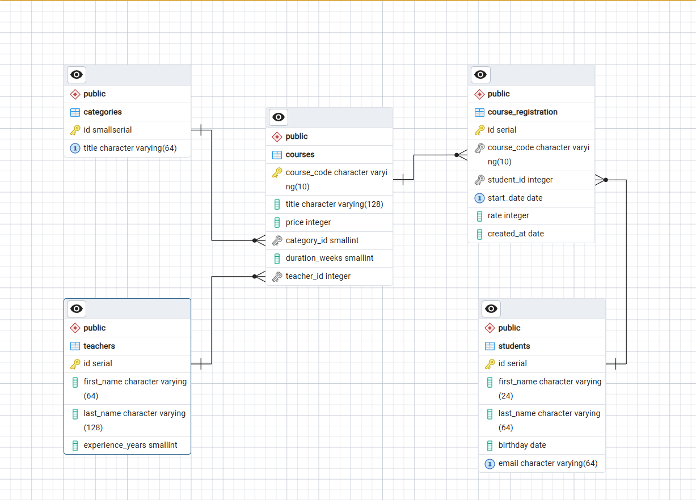

# Нормалізація бази даних

## 1. Схема бази даних

## 2. Функціональні залежності та потенційні ключі

### 2.1. Students

#### Атрибути

id, first_name, last_name, birthday, email

#### Функціональні залежності

- id → first_name, last_name, birthday, email, оскільки id є первинним ключем.
- email → id, first_name, last_name, birthday, оскільки email є унікальним і обов'язковим.

#### Потенційні ключі

- id - PRIMARY KEY.
- email - UNIQUE NOT NULL (альтернативний потенційний ключ).

### 2.2. Teachers

#### Атрибути

id, first_name, last_name, experience_years

#### Функціональні залежності

- id → first_name, last_name, experience_years, оскільки id є первинним ключем.

#### Потенційні ключі

- id -PRIMARY KEY.

### 2.3. Categories

#### Атрибути

id, title

#### Функціональні залежності

- id → title (первинний ключ).
- title → id (унікальний та обов'язковий атрибут).

#### Потенційні ключі

- id - PRIMARY KEY.
  -title — UNIQUE, NOT NULL (альтернативний потенційний ключ).

### 2.4. Courses

#### Атрибути

course_code, title, price, category_id, duration_weeks, teacher_id

#### Функціональні залежності

- course_code → title, price, category_id, duration_weeks, teacher_id (первинний ключ).

#### Потенційні ключі

- course_id - PRIMARY KEY.

### 2.5. Course Registration

#### Атрибути

id, course_code, student_id, start_date, rate, created_at

#### Функціональні залежності

- id → course_code, student_id, start_date, rate, created_at (первинний ключ).
- (course_code, student_id, start_date) → id, rate, created_at (унікальна комбінація атрибутів).

#### Потенційні ключі

- id - PRIMARY KEY.
- (course_code, student_id, start_date) - UNIQUE (унікальна комбінація атрибутів)

## 3. Обґрунтування відповідності 3НФ

База даних спроєктовна з урахуванням принципів нормалізації. Кожна сутність зберігається в окремій таблиці, а зв'язки між таблицями реалізовані за допомогою первинних і зовнішніх ключів.

Таблиці students, teachers, categories та courses містять дані, що характеризують відповідні сутності. Наприклад, інформація про викладачів зберігається в таблиці teachers, а в таблиці courses використовується зовнішній ключ teacher_id. Це дозволяє уникнути дублювання інформації про викладачів у записах курсів. Аналогічно реалізовано зв'язок між категоріями та курсами.

Зв'язок «багато до багатьох» між студентами та курсами реалізований через проміжну таблицю course_registration. Вона зберігає дані, що стосуються саме реєстрації студента на курс: дату початку навчання, дату створення реєстрації та оцінку. Унікальність комбінації course_code, student_id і start_date не дозволяє створювати повторні реєстрації з однаковими значеннями цих атрибутів.

Схема бази даних відповідає вимогам нормальних форм:

Перша нормальна форма (1НФ): усі таблиці мають атомарні значення атрибутів, відсутні повторювані групи даних.

Друга нормальна форма (2НФ): кожен неключовий атрибут повністю функціонально залежить від кожного потенційного ключа. Зокрема, у таблиці course_registration атрибути rate та created_at залежать від усієї комбінації складеного потенційного ключа, а не від окремої її частини.

Третя нормальна форма (3НФ): відсутні транзитивні залежності неключових атрибутів від потенційних ключів. Неключові атрибути залежать від ключів своїх таблиць, а не від інших неключових атрибутів.

Таким чином, структура бази даних відповідає третій нормальній формі, що дозволяє зменшити надлишковість даних та уникнути аномалій під час їх додавання, оновлення й видалення.
